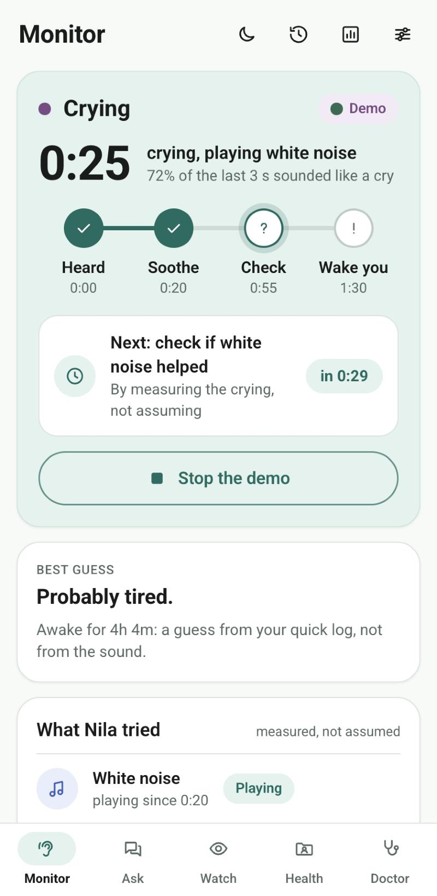
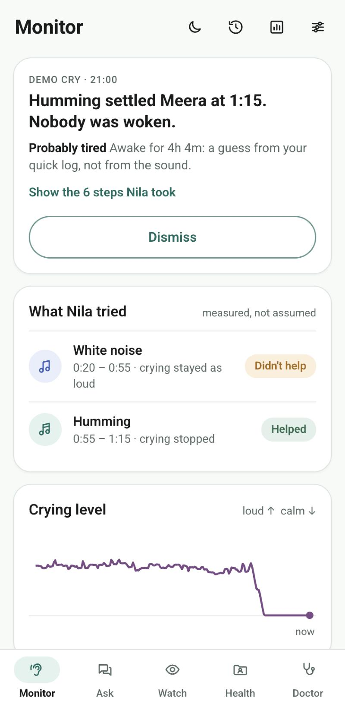
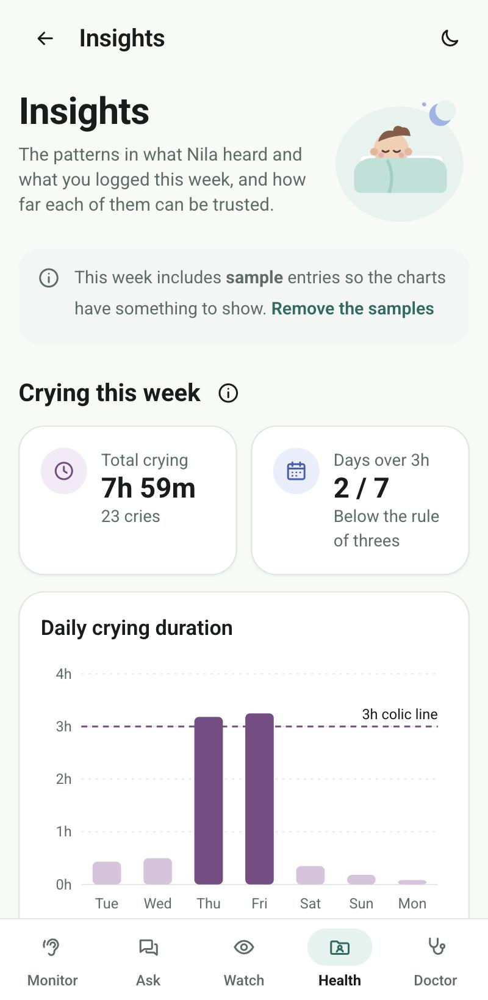
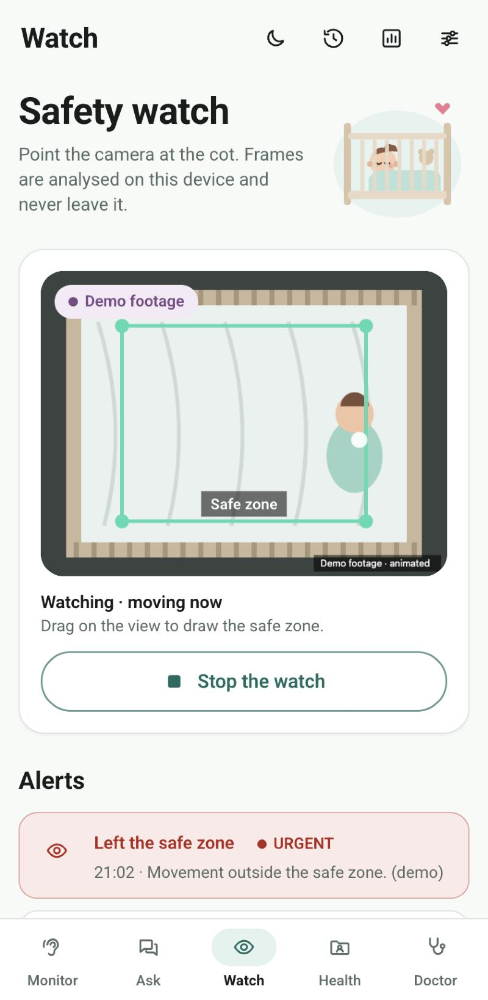

# Nila

**A baby monitor that settles before it wakes you.** Nila runs in the browser of the
phone or laptop a family already owns. When the baby cries it plays a soothing
sound, **measures whether that sound actually helped**, and only wakes a parent if it
did not, with an alert that says what it already tried. It remembers which sound
settles *this* baby and tries that one first next time.

Around that: a timeline and weekly insights, a camera safety watch with a safe zone,
babyproofing a room from one photo, sourced answers, a medicine check for the
breastfeeding mother, the doctor's visit written down as reminders, health records
and a skin diary. Everything is stored on the device. There is no account and no
server.

<p align="center">
  
  
  
  
</p>

**Try it:** https://nandini-kuppala.github.io/Nila2.O/ (Chrome, Edge or Safari; phone or laptop)

---

## The idea

Every baby monitor ends at *notify*. That treats a baby who would have settled in
forty seconds the same as one who needs a parent, and wakes households that did not
need waking. Nila adds two rungs before the alarm:

```
Heard ──► Soothe ──► Check ──► Wake you
0:00      0:20       0:55      1:30
```

1. **Heard.** A sustained, baby-pitched cry for about three seconds starts an episode.
   A cry that stops by itself before 0:20 closes as "settled on her own".
2. **Soothe.** At 0:20 Nila plays a sound: the one with the best record for this baby,
   or the next untried one (white noise, humming a lullaby, or the parent's own
   recorded voice).
3. **Check.** It compares the crying level in the 10 seconds before the sound with the
   last 15 seconds of it. A drop of 60% or more is **Helped**; otherwise
   **Didn't help**, and it tries the next sound. *Measured, not assumed.*
4. **Wake you.** At 1:30, if nothing helped, a full-screen alert with an alarm lists
   what was tried, plus a guess at why ("probably hungry: last feed 3h 10m ago"),
   taken from the quick log and labelled as a guess.

Nila deliberately does **not** guess the cause from the sound. In the team's earlier
work, cry-cause models tested on babies they had not heard before scored no better
than chance.

## Try the demo

You don't need a baby. On **Monitor**, press **Try a demo cry**:

- **A cry that settles.** A synthesized cry goes through the same detector as the
  microphone. The scripted demo baby calms to humming or a voice, not to white noise.
  Run it twice: the second time Nila starts with humming, and she settles sooner.
- **A cry that needs you.** Nothing settles her, so Nila wakes you at the last rung.

**Settings → Demo speed** runs the ladder 3× faster for a short recording.
**Insights → Add a sample week** fills the charts with clearly labelled sample data
that can be removed in one tap. **Watch → Play demo footage** runs an animated
stand-in scene through the safety watch.

## What each tab does

| Tab | What works |
|---|---|
| **Monitor** | Microphone listening, the ladder, soothing sounds, a measured verdict per sound, learning which sound works, the wake alert (sound, vibration, notification), the clip of a cry that woke you, the quick log (feed, nappy, sleep) and a reason guess from it. |
| Timeline · Insights | One entry per cry with its steps and recording; filters for today, yesterday, 7 and 30 days; the week's crying against the 3-hour colic line; what settles her; how cries ended; when she cries. |
| **Ask** | A curated set of answers with sources (NHS, AAP, NIH), a "Worth knowing" warning on each, an honest "no sourced answer" when nothing matches, and "When did she last feed?" answered from the log. **Check a medicine** gives a breastfeeding verdict for 25 common medicines, including Indian brands (Crocin, Dolo 650, Combiflam…). |
| **Watch** | The camera with a safe zone you drag to draw. Movement outside it raises an urgent alert; the whole view jumping raises "the phone was moved". Optional person detection, a ring-light flash and a lullaby on alerts. **Babyproof a room**: one photo, objects detected in the browser, numbered pins and "Fix these" cards with sources, plus a checklist for what no camera can see. |
| **Health** | Baby and mother records (vaccinations, check-ups, prescriptions, growth) with photos. **Little Signs → Skin diary**: a photo every few days with a circle around the mark, a size trend, and "Doctor this week" when it grows by half within four days. |
| **Doctor** | Dictate the visit (browser speech recognition, English, Hindi, Tamil, Telugu) or type it. Nila writes down medicines with amounts and times, dates, what was given today and the advice, in the doctor's words. **Set reminders** saves them to Nila's calendar and downloads an `.ics` file for the phone's calendar. |

## Run it locally

Needs Node 18 or newer. There are no dependencies to install.

```bash
npm start
```

Open http://localhost:5173. The microphone and camera need `localhost` or HTTPS.

```bash
npm test
```

51 tests cover the cry detector, the ladder and its verdicts, sound choice, the reason
guess, the summaries, the sample week, the movement tracker, search, the medicine
lookup, the visit parser and calendar file, and the skin-diary rules.

## How it works

Plain HTML, CSS and JavaScript modules: no framework and no build step.

- **Ear** (`js/monitor/detector.js`). Twenty times a second it takes ~40 ms of sound
  and asks: is it loud compared with the room (an adaptive noise floor), and does it
  have a steady pitch between 300 and 750 Hz (autocorrelation)? White noise has no
  pitch, and humming and adult speech sit below 300 Hz, so neither counts.
- **Ladder** (`js/monitor/ladder.js`). A pure state machine, fed the ear's readings
  and the clock. It is what the tests drive.
- **Engine** (`js/monitor/audio-engine.js`). Web Audio for the microphone, the demo
  cry, the sounds and the alarm, and MediaRecorder for the clip.
- **Watch** (`js/watch/tracker.js`). Frame-to-frame movement on a 64×48 grid, plus
  optional COCO-SSD person detection.
- **Storage** (`js/store.js`). IndexedDB in this browser. **Settings → Clear
  everything** removes it all.

## Honest limits

- The cry detector is a pitch-and-loudness rule, not a trained model. It is good
  enough to tell a cry from white noise, humming and talk, but it has not been
  validated on real nurseries.
- Browsers can pause the microphone when the screen locks or the tab is in the
  background. Keep Nila on screen and the phone plugged in. Background listening needs
  a native wrapper.
- Babyproof uses a general-purpose model (COCO-SSD). On test photos it found a TV, a
  sofa and chairs, but missed a gas stove; it does not know sockets or cords. The
  screen says so, and always shows the general checklist.
- In Chrome, dictating a doctor's visit uses the browser's speech service, which sends
  the audio to the browser vendor. Typing the notes keeps everything on the device.
- Not a medical device, not a breathing monitor, and nothing here is a diagnosis.

## Built with the Devpost Learn skill pack

This project was planned and built with the
[Devpost Learn skill pack](https://github.com/challengepost/learn-ai-basics)
(`npx skills add challengepost/learn-ai-basics --all -y`), in a coding agent, from an
empty folder. The planning documents are in [`devpost/`](devpost):
[scope](devpost/scope.md), [PRD](devpost/prd.md), [spec](devpost/spec.md) and the
[build checklist](devpost/checklist.md), with a revision log of what the build
discovered. The skills themselves are in `.agents/skills/`.

### Where this came from

Nila started as an idea our team had before this hackathon. This repository is a new
build, started from an empty folder for Build With AI: Basics. The look of the screens
(layout, colour palette and the moon logo in `assets/`) follows our team's own earlier
Nila design.

Third-party pieces: TensorFlow.js and COCO-SSD (Apache-2.0), loaded from jsDelivr only
when Watch or Babyproof needs them; the Roboto font from Google Fonts; the
melody of *Brahms' Lullaby* (1868, public domain) for the humming. Health answers
summarise and link the NHS, the American Academy of Pediatrics and NIH LactMed.

## Licence

[MIT](LICENSE)
